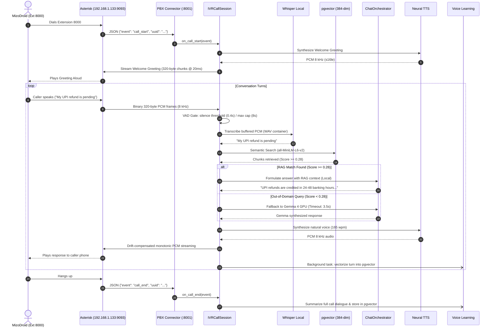
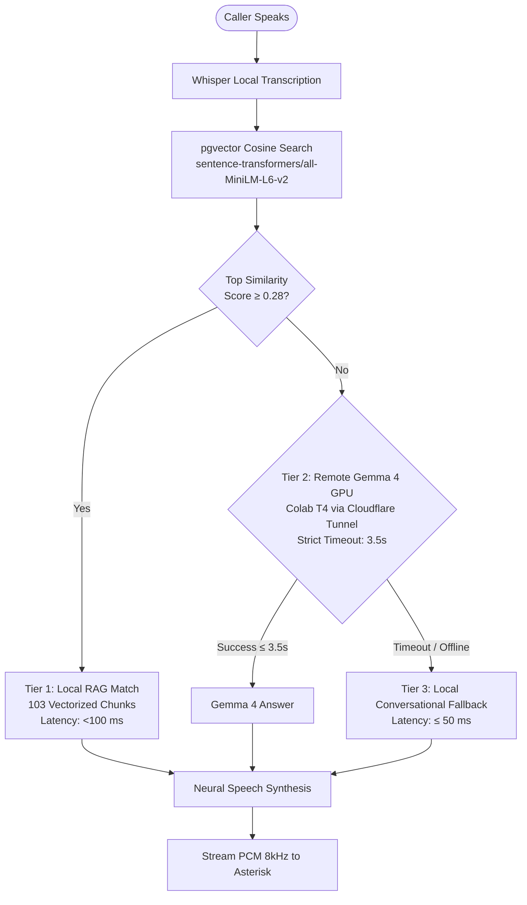

# AI Platform & Voice Telephony Architecture

The standalone AI platform is designed around strict separation of concerns, zero vendor lock-in, pluggable provider contracts, and low-latency real-time voice telephony (SIP/Asterisk PBX).

---

## 1. System Topology & Dual-Service Architecture

The platform operates as a coordinated dual-service system:

```mermaid
flowchart TD
    subgraph Clients["Inbound Caller & Client Interfaces"]
        SIPClient["SIP Mobile Client (MizoDroid)<br/>Extension 8000"]
        Browser["Web Browser Console<br/>localhost:8000"]
    end

    subgraph PBX["PBX Telephony Layer"]
        Asterisk["Asterisk PBX Server<br/>192.168.1.133:9093<br/>(AudioSocket / WebSocket Bridge)"]
    end

    subgraph Port8000["Port 8000: Django Com-one Intelligence Layer"]
        UI["Interactive Telephony Agent UI"]
        Proxy["Reverse Proxy (/v1/* -> :8001)"]
        CRM["CRM Customer Surfacing"]
        Cognitive["4-Stage Cognitive Voice Pipeline"]
    end

    subgraph Port8001["Port 8001: FastAPI AI Platform Engine"]
        PBXConn["PBX WebSocket Connector<br/>(telephony/pbx_connector.py)"]
        IVRSession["IVR Call Session & VAD Gate<br/>(telephony/ivr_session.py)"]
        LocalSTT["Whisper Local STT<br/>(openai/whisper-tiny)"]
        RAG["pgvector Semantic Search<br/>(all-MiniLM-L6-v2, 384-dim)"]
        Orchestrator["Chat Orchestrator & Router"]
        TTS["Neural TTS Engine<br/>(Edge-TTS / macOS say @ 165 wpm)"]
        VoiceLearning["Continuous Voice Learning Engine<br/>(telephony/voice_learning.py)"]
    end

    subgraph RemoteFallback["Remote GPU Fallback (Optional)"]
        GemmaGPU["Google Gemma 4 E2B IT<br/>(Colab T4 GPU via Cloudflare Tunnel)"]
    end

    subgraph Storage["Persistent Storage Layer"]
        Postgres[("PostgreSQL 16 + pgvector<br/>(ai_platform_test)")]
        SQLite[("Com-one SQLite DB<br/>(comone_v2.db)")]
    end

    SIPClient <-->|RTP / SIP Audio| Asterisk
    Asterisk <-->|Raw PCM s16le 8kHz| PBXConn
    Browser <-->|HTTP / WS| Port8000

    Port8000 -->|Reverse Proxy /v1/*| Port8001
    PBXConn <--> IVRSession
    IVRSession --> LocalSTT
    IVRSession --> RAG
    RAG <--> Postgres
    IVRSession --> Orchestrator
    Orchestrator -.->|Score < 0.28 (Timeout 3.5s)| GemmaGPU
    Orchestrator --> TTS
    IVRSession --> VoiceLearning
    VoiceLearning --> Postgres
    Cognitive <--> SQLite
```

---

## 2. Core Service Responsibilities

### Service A: Django Com-one Web Platform (`:8000`)
- **Interactive UI Console (`/` and `/ui`)**: Provides live operator controls, audio player, caller persona switcher, and knowledge base browser.
- **Transparent OpenAI API Reverse Proxy (`/v1/*`)**: Forwards all `/v1/documents`, `/v1/chat/completions`, and `/v1/audio/*` calls to the FastAPI backend on `:8001`.
- **Telephony Simulator API (`/api/v2/telephony/*`)**: Supports web-based microphone calling with real-time VAD audio processing.
- **CRM Integration & Supervisor Monitor**: Automatically surfaces VIP customer records (e.g. Rahul Kumar, Tier: VIP Customer) and logs call detail records (CDRs).

### Service B: FastAPI AI Platform Core (`:8001`)
- **OpenAI-Compatible REST Layer**: Provides `/v1/chat/completions`, `/v1/models`, `/v1/documents`, `/v1/audio/transcriptions`, and `/v1/audio/speech`.
- **Asterisk PBX Connector**: Long-lived background daemon maintaining persistent WebSocket connection to `ws://192.168.1.133:9093` with auto-reconnect.
- **Real-Time Voice Pipeline**: Ingestion of raw 8 kHz PCM caller frames, voice activity detection (VAD), Whisper transcription, semantic retrieval, and chunk-paced TTS audio return.
- **Continuous Learning Worker**: Background task that synthesizes new Q&A pairs from voice turns and multi-turn call summaries into `pgvector`.

---

## 3. End-to-End Voice Telephony Flow (MizoDroid $\leftrightarrow$ Asterisk $\leftrightarrow$ AI)



---

## 4. PCM Audio Wire Specifications

| Property | Value | Notes |
|---|---|---|
| **Audio Format** | `pcm_s16le` | Signed 16-bit little-endian raw linear PCM |
| **Channels** | `1` (Mono) | Single audio channel |
| **Sampling Rate** | `8 000 Hz` | Standard telephony narrowband audio |
| **Frame Size** | `320 bytes` | Exactly 160 samples per frame |
| **Frame Interval** | `20 ms` | $160 \div 8000\text{ s} = 0.020\text{ s}$ |
| **Streaming Pacing** | `time.monotonic()` | Drift-compensated clock to prevent packet starvation |
| **VAD Silence Gate** | `0.40 seconds` | Minimum speech threshold before triggering Whisper STT |
| **VAD Hard Cap** | `8.0 seconds` | Maximum speech buffer accumulation |

---

## 5. 3-Tier LLM & Knowledge Routing Strategy

To guarantee zero dead-air during live phone calls while maximizing intelligence:



1. **Tier 1 — Local pgvector RAG (Score $\ge 0.28$)**:
   - Covers greetings, banking, UPI refunds, card blocking, account balance, video KYC, branch timings, and order tracking.
   - Operates 100% locally on CPU without external API calls in $<100\text{ ms}$.
2. **Tier 2 — Colab Gemma 4 GPU Fallback**:
   - Out-of-domain or open-ended inquiries route to Google Gemma 4 E2B on Colab GPU.
   - Guarded by a strict **3.5-second timeout** to protect the phone caller from long pauses.
3. **Tier 3 — Instant Local Failover ($\le 50\text{ ms}$)**:
   - If Colab crashes, drops connection, or exceeds 3.5s, the local engine immediately steps in with a polite, natural spoken response.

---

## 6. Continuous Voice Learning Engine

Every conversation turn and completed call dynamically expands the knowledge base:

1. **Turn-Level Learning (`learn_from_voice_turn`)**:
   - Filters out non-informative one-word utterances and small talk.
   - Evaluates semantic deduplication threshold ($>0.92$ similarity against existing chunks).
   - Generates 384-dimensional embedding using `semantic-default`.
   - Inserts newly learned Q&A pair into `document_chunks` under the title `"Continuous Voice Call Learnings"`.
2. **Call-Level Summarization (`learn_from_call_summary`)**:
   - Triggered on `call_end`.
   - Synthesizes multi-turn dialogue into a structured summary (Caller Intent, Inquiries, Resolution, Action Items).
   - Indexes summary into `pgvector` tied to `tenant_id` and `call_uuid`.

---

## 7. Multitenancy, Security & Database Schema

### PostgreSQL Schema (`ai_platform_test`)
- **`tenants`**: Multi-tenant partitioning (`id`, `name`, `created_at`). Active IVR tenant: `879e9bda-8049-4824-9aa0-fc5e9f0012d9` (`tenant-ivr-support`).
- **`api_keys`**: Hashed keys using SHA-256 (`key_hash`, `tenant_id`, `scopes`, `is_active`). Raw keys are never stored.
- **`documents`**: Metadata for ingested knowledge manuals (`id`, `tenant_id`, `title`, `source_type`, `total_chunks`).
- **`document_chunks`**: Vector storage (`id`, `document_id`, `tenant_id`, `content`, `embedding Vector(384)`, `meta_json`).

### SQLite Schema (`comone_v2.db`)
- **`call_sessions`**: Session metadata, caller phone number, duration, sentiment score, language.
- **`conversation_turns`**: Chronological transcript per turn with speaker label (`caller` / `agent`), intent, emotion, and latency.
- **`call_detail_records` (CDRs)**: Dispositions (`RESOLVED_BY_AI`, `TRANSFERRED_TO_HUMAN`), duration, timestamps.
