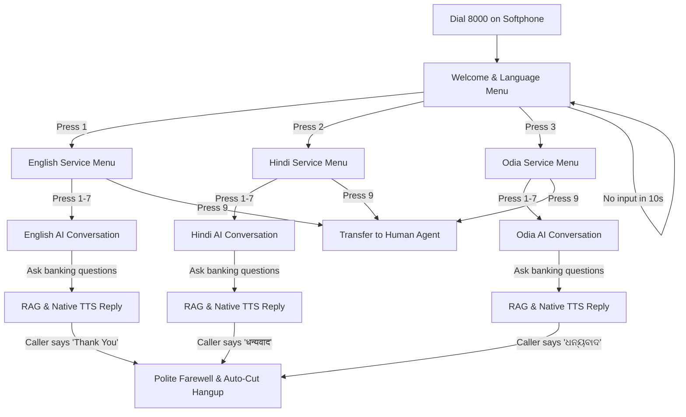

# IVR Telephony & AI Voice Agent — Test User Guidebook

This guidebook provides step-by-step instructions, test scenarios, keypad maps, and sample voice queries for testing the **Multilingual IVR Telephony & Conversational AI Agent**.

---

## 1. Quick Setup & Connection

### 1.1 SIP Softphone Setup (MizoDroid / Linphone / Zoiper)
1. Install **MizoDroid** (Android) or **Linphone** / **Zoiper** on your test phone or PC.
2. Configure SIP Account settings:
   - **SIP Server / Domain**: `192.168.1.133` (or local PBX IP)
   - **SIP Port**: `5060` (UDP)
   - **Username / Extension**: Your assigned extension (e.g., `1001`, `1002`)
   - **Password**: Assigned SIP password
   - **Audio Codec**: G.711u / G.711a (PCMU / PCMA)
3. Confirm registration status displays **Registered / Online** (Green indicator).

### 1.2 Target Extension
- **Extension to Dial**: `8000`
- **Call Type**: Audio Voice Call

---

## 2. Complete Call Flow Architecture



---

## 3. Menu Navigation & DTMF Keypad Map

### Menu 1: Welcome & Language Selection
Upon dialing `8000`, the system plays the trilingual welcome prompt:
> *"Namaste! Thank you for calling customer support. Please choose your preferred language to continue. Press 1 for English. हिंदी के लिए 2 दबाएं। ଓଡ଼ିଆ ପାଇଁ 3 ଦବାନ୍ତୁ। To repeat this menu, press 0."*

| Key Pressed | Action | Description |
| :---: | :--- | :--- |
| **`1`** | **English** | Sets session language to English and advances to English Service Menu. |
| **`2`** | **Hindi (हिंदी)** | Sets session language to Hindi and advances to Hindi Service Menu. |
| **`3`** | **Odia (ଓଡ଼ିଆ)** | Sets session language to Odia and advances to Odia Service Menu. |
| **`0`** | **Repeat Menu** | Replays the language prompt immediately. |
| *No input* | **Timeout** | Prompts caller after 10s and replays up to 3 times before graceful disconnect. |

---

### Menu 2: Service Selection Menu
Spoken in the language selected in Menu 1.

| Key | Service Category | What It Tests |
| :---: | :--- | :--- |
| **`1`** | **Customer Support** | General banking enquiries, branch hours, assistance. |
| **`2`** | **Register a Complaint** | Failed ATM withdrawals, unauthorized charges, service delays. |
| **`3`** | **UPI & Payment Issues** | Pending transfers, failed debits, refund timelines. |
| **`4`** | **Account & Banking** | Balance enquiries, statement requests, KYC requirements. |
| **`5`** | **Card Services** | Debit/Credit card activation, limit upgrade, PIN reset, blocking. |
| **`6`** | **Loans & EMI** | Personal loans, home loans, interest rates, EMI due dates. |
| **`7`** | **General Enquiries** | Fixed deposits, internet banking, general questions. |
| **`9`** | **Representative Transfer** | Plays human transfer announcement. |
| **`0`** | **Repeat Menu** | Replays current service menu. |
| **`*`** | **Go Back** | Returns to Language Selection menu. |

---

## 4. Test Scenarios & Voice Queries

After pressing **1 to 7**, the agent acknowledges your selection and enters **Live AI Conversation**.

### Scenario A: English Caller Testing
**Flow**: Dial `8000` $\rightarrow$ Press `1` $\rightarrow$ Press `3` (UPI Support)

| Step | Caller Utterance / Action | Expected Agent Behavior |
| :--- | :--- | :--- |
| 1 | *"My money was deducted from UPI but the merchant did not receive it."* | Explains UPI auto-reversal within 24 to 48 hours in clear English. |
| 2 | *"What documents do I need for Video KYC?"* | Lists Original PAN Card, Aadhaar, and blank paper for signature. |
| 3 | *"Thank you so much!"* | Replies: *"You are most welcome! Thank you for contacting our customer support service. Have a wonderful day ahead!"* and **automatically hangs up the call**. |

---

### Scenario B: Hindi Caller Testing (हिंदी)
**Flow**: Dial `8000` $\rightarrow$ Press `2` $\rightarrow$ Press `1` (कस्टमर सपोर्ट)

| Step | Caller Utterance / Action | Expected Agent Behavior |
| :--- | :--- | :--- |
| 1 | *"वीडियो केवाईसी के लिए मुझे क्या तैयार रखना होगा?"* | Replies in fluent Hindi (Swara Neural voice) stating physical PAN card, Aadhaar, and good lighting. |
| 2 | *"यूपीआई रिफंड कब तक आ जाएगा?"* | Explains 3 to 5 working days auto-refund policy. |
| 3 | *"धन्यवाद"* (or *"शुक्रिया"*) | Replies: *"आपका बहुत-बहुत धन्यवाद! हमारी ग्राहक सेवा में संपर्क करने के लिए आभार। आपका दिन शुभ हो!"* and **automatically cuts the call**. |

---

### Scenario C: Odia Caller Testing (ଓଡ଼ିଆ)
**Flow**: Dial `8000` $\rightarrow$ Press `3` $\rightarrow$ Press `4` (ଖାତା ଏବଂ ବ୍ୟାଙ୍କିଙ୍ଗ)

| Step | Caller Utterance / Action | Expected Agent Behavior |
| :--- | :--- | :--- |
| 1 | *"ଭିଡିଓ କେୱାଇସି ପାଇଁ କଣ ଦରକାର?"* | Replies in native Odia (MMS-TTS) explaining PAN card and Aadhaar requirements. |
| 2 | *"ଧନ୍ୟବାଦ"* | Replies: *"ଆପଣଙ୍କୁ ବହୁତ ବହୁତ ଧନ୍ୟବାଦ! ଆମ ଗ୍ରାହକ ସେବା ସହିତ ଯୋଗାଯୋଗ କରିଥିବାରୁ କୃତଜ୍ଞତା। ଆପଣଙ୍କ ଦିନଟି ଶୁଭମୟ ହେଉ!"* and **automatically cuts the call**. |

---

## 5. Feature Validation Checklist for QA

| Feature | How to Test | Acceptance Criteria | Pass / Fail |
| :--- | :--- | :--- | :---: |
| **Instant DTMF Barge-In** | Press a keypad key (e.g. `1`) while prompt audio is actively playing. | Audio stops instantly (<50ms) and menu advances immediately. | [ ] |
| **Language Lock** | Select Hindi (`2`), then ask a question in English or Hinglish. | Agent strictly answers in native Hindi Devanagari. | [ ] |
| **Speech Quality & Tone** | Listen to cadence, pronunciation, and pacing. | Natural 165 wpm cadence, no robotic pauses, feminine grammatical gender. | [ ] |
| **No Metadata Readout** | Ask about KYC or UPI chunks. | Audio never reads technical headers (`Audio Prompt ID`, `Voice Transcript`). | [ ] |
| **Single-Sentence Precision** | Ask multi-part banking query. | Agent delivers 1-2 spoken sentences (under 35 words); no repetitive bullet loops. | [ ] |
| **Auto-Cut Hangup** | Say *"Thank you"*, *"धन्यवाद"*, or *"ଧନ୍ୟବାଦ"*. | Plays farewell audio completely, waits 0.8s, and disconnects automatically. | [ ] |
| **Continuous Learning** | Ask a novel unindexed question, then repeat it on a subsequent call. | Voice turn is saved to `pgvector` and referenced in future responses. | [ ] |

---

## 6. Real-Time Terminal Log Verification

When testing, monitor the live server console:
```bash
tail -f ai-platform.log
# OR observe active uvicorn terminal
```

Look for these operational log signatures:
- `[PBX] 📞 Call started from caller: '1001' | uuid=...`
- `[IVR] 🔢 on_dtmf digit='1' | Current State=IVRState.LANGUAGE_SELECTION`
- `[IVR] 🚀 Handoff to AI_CONVERSATION complete. Listening for caller voice...`
- `[IVR] 🎙️ Caller Voice Transcribed: 'what is video kyc'`
- `[IVR] Executed native pgvector cosine search ... found 3 matching chunks.`
- `[IVR] AI reply: 'For Video KYC, please keep your original PAN card...'`
- `[IVR] 📞 Closing farewell turn detected ('thank you'). Auto-cutting call...`
- `[IVR] 📵 Call ended: uuid=...`

---

## 7. Troubleshooting Guide

| Symptom | Probable Cause | Resolution |
| :--- | :--- | :--- |
| **Call drops immediately upon dialing 8000** | PBX WebSocket Connector disconnected or server down. | Check `PBX connector started → ws://192.168.1.133:9093` in logs. Verify port 8001 is running. |
| **No audio heard after picking up** | RTP audio codec mismatch or microphone permissions muted. | Check MizoDroid audio settings: enable PCMU / PCMA, ensure mic permission is granted. |
| **Keypad press ignored** | DTMF signalling mode in softphone is set incorrectly. | Set DTMF mode in MizoDroid / Linphone to **RFC 2833** or **SIP INFO**. |
| **Agent speaks incorrect language** | Inadvertent keypress during Menu 1. | Press `*` to go back to language selection or redial and select `1` (EN), `2` (HI), or `3` (OR). |
| **Agent doesn't respond to speech** | Microphone input level too low (below VAD threshold). | Speak at normal conversational volume close to microphone. |

